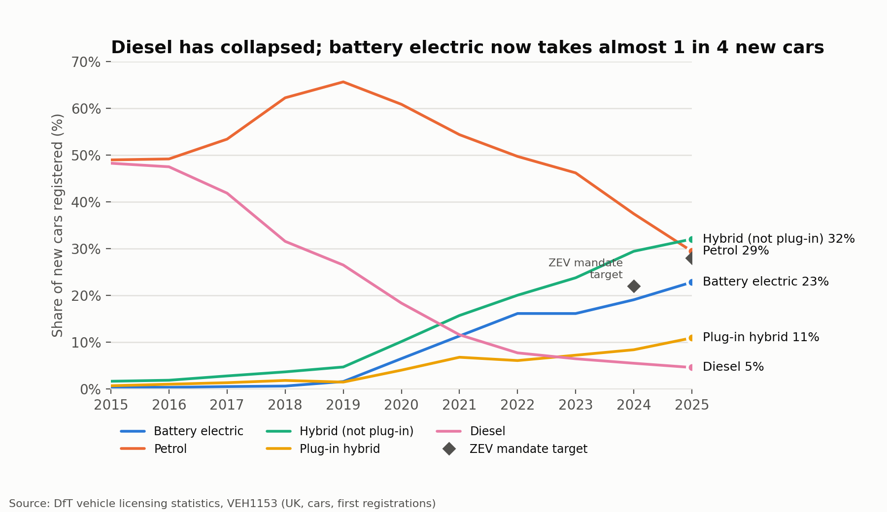
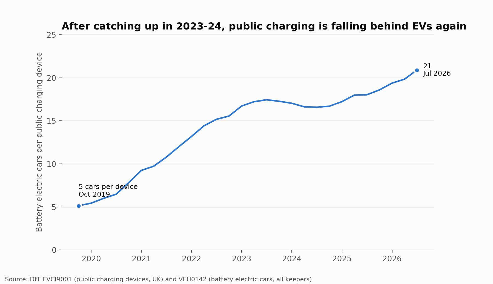
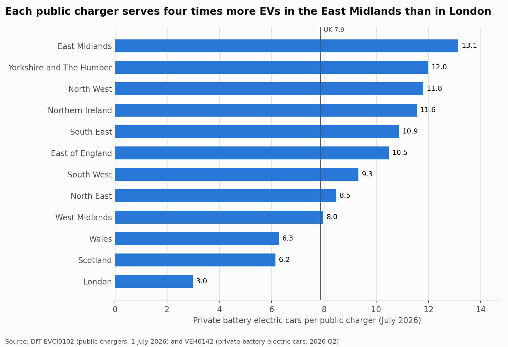
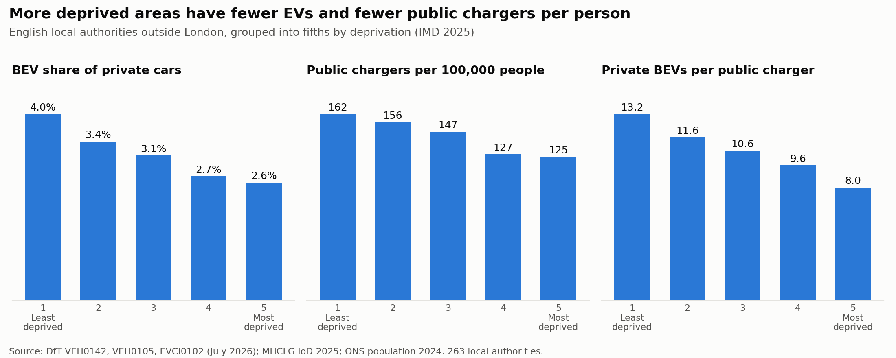
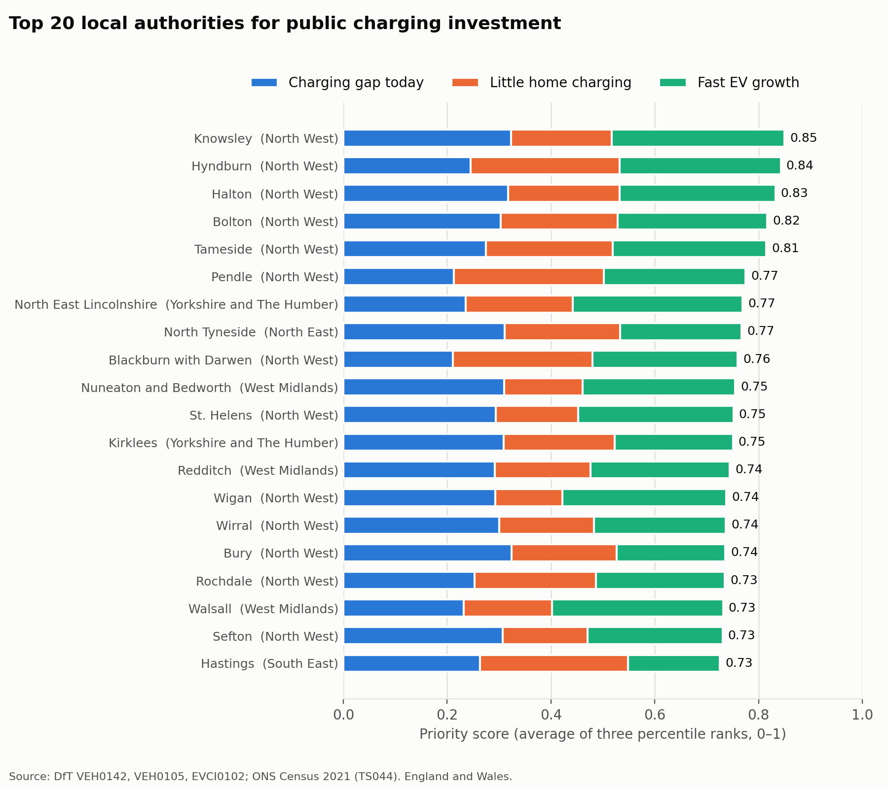
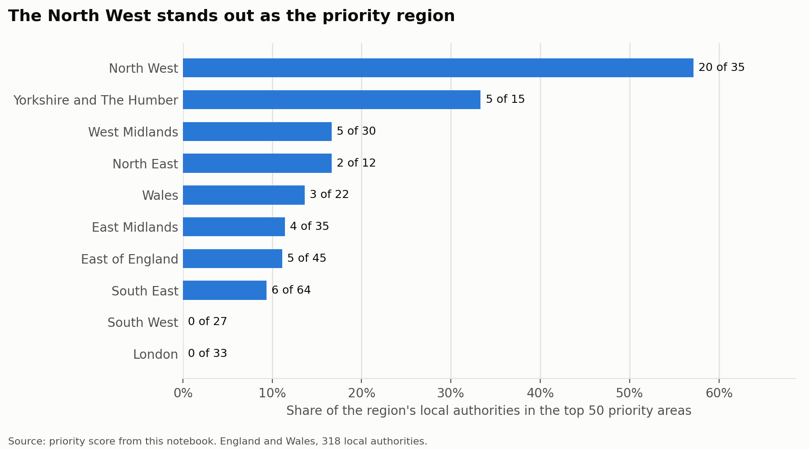

# UK EV Adoption vs Charging Infrastructure

Is the UK's public charging network keeping pace with electric vehicle adoption, and where should charge point investment go next?

This project combines government open data on licensed vehicles, public chargers, income, deprivation and housing for every UK local authority. It answers four business questions and ends with a ranked list of priority areas for investment.

## Summary

- **The shift to electric is fast.** Battery electric cars were 0.4% of new cars in 2015, 22.8% in 2025 and 27.3% in Q2 2026. They are still only 5.8% of cars on the road (1.98 million), but that number grew by 34% in the last year.
- **Public charging is falling behind again.** Battery electric cars per public charging device rose from 5 in 2019 to about 17 in 2023, held steady through 2024, and have risen again to 21 since 2025.
- **The gap is regional.** The East Midlands has more than four times as many private EVs per public charger as London (13.1 against 3.0).
- **Adoption follows income.** Richer areas have more EVs (correlation 0.7). Deprived areas also have about a fifth fewer public chargers per person.
- **Recommendation:** prioritise the **North West** (Greater Manchester, Merseyside, east Lancashire) and similar towns in the North and Midlands. These areas combine a charging gap today, many households without a driveway and fast EV growth. The need there is mainly on-street and neighbourhood charging.

## Business questions and answers

### 1. How fast is the fleet shifting to battery electric vehicles?



- The battery electric share of new cars rose from **0.4% (2015) to 22.8% (2025)** and reached **27.3% in Q2 2026**.
- Diesel collapsed from 48% to 5% of new cars over the same period. In 2025 the largest group was non-plug-in hybrids (32%).
- The fleet changes much more slowly than sales: battery electric cars are **5.8%** of licensed cars, up 4.1 times since 2022.

Notebook: [03_bev_adoption_speed](notebooks/03_bev_adoption_speed.ipynb)

### 2. Where are the biggest charging gaps?





- Nationally, charging caught up in 2023–2024, but **since 2025 EVs have again grown faster than chargers.** In the last year, devices grew by 15% and battery electric cars by 34%.
- **London has 3.0 private EVs per public charger; the East Midlands, Yorkshire and the North West have about 12–13.**
- The largest local gaps are in suburban and semi-rural districts (North East Derbyshire, Fareham, Melton). Many residents there can charge at home, so a high ratio alone does not mean the highest need.

Notebook: [04_charging_gap](notebooks/04_charging_gap.ipynb)

### 3. How does EV adoption relate to income and deprivation?



- **Richer areas have more EVs.** The correlation between income per head and the battery electric share of private cars is 0.71. Outside London, the correlation with deprivation is −0.72.
- In England outside London, the battery electric share falls from **4.0% in the least deprived fifth** of local authorities to **2.6% in the most deprived fifth**.
- **Public charging has followed the early adopters.** The most deprived areas have about a fifth fewer chargers per person (125 against 162 per 100,000 people). They do not look short of chargers today only because they have few EVs yet.

Notebook: [05_income_deprivation](notebooks/05_income_deprivation.ipynb)

### 4. Where should investment go?

A simple priority score for 318 local authorities in England and Wales. It is the average of three percentile ranks:

| Indicator | Reason to invest |
| --- | --- |
| Private battery electric cars per public charger | gap today |
| Households in flats or terraced houses (Census 2021) | residents unlikely to have a driveway |
| Growth in private battery electric cars in the last year | where demand is heading |





- The top five are **Knowsley, Hyndburn, Halton, Bolton and Tameside.** 20 of the 35 North West local authorities are in the national top 50. None of London's 33 boroughs are.
- The ranking is robust to the weights used. When any one indicator counts double, 12 to 18 of the top 20 stay in the top 20.
- **Indicative size:** bringing the top 20 areas to the national median would need about **1,850 extra public chargers**, on top of the 2,700 they have today.

The full ranking is in [outputs/priority_ranking.csv](outputs/priority_ranking.csv). Notebook: [06_investment_priorities](notebooks/06_investment_priorities.ipynb)

## Recommendations

1. **Focus the next round of public charging investment on the North West** (Greater Manchester, Merseyside, east Lancashire), then on similar towns in Yorkshire, the North East and the West Midlands.
2. **Invest in on-street and neighbourhood charging in these areas**, such as lamp-post chargers and residential hubs, for households without a driveway. Rapid chargers alone are not enough there.
3. **Plan ahead of demand in deprived areas.** EV adoption there is low today, but it will rise as EVs become cheaper, and these residents depend more on public charging.
4. **Lower priority:** inner London, which is already the best served, and rural areas of detached houses, where home charging covers most needs. Rapid charging on main roads is outside the scope of this analysis.

## Method notes and limitations

- **Company cars.** Company and lease cars are registered at the company's address. For example, Windsor and Maidenhead has 200,000 battery electric cars, 98% of them company owned. All local comparisons therefore use **privately kept cars only**, about half of all battery electric cars. Local ratios are best read as relative measures for comparing areas.
- **Cross-check.** The regional ratios, deprivation groups and top 20 priority areas were recalculated in SQL and match the Python results ([notebook 07](notebooks/07_sql_checks.ipynb)).
- **Chargers and devices.** The DfT publishes two counts: *chargers* (local snapshot, July 2026) and *devices* (time series since 2019). Each is used for its own purpose and they are never mixed.
- **Home charging.** Flats and terraced houses are a proxy for "no driveway", taken from Census 2021. Some terraces have parking and some detached houses do not.
- **Coverage.** Deprivation (IMD 2025) covers England only. The priority score covers England and Wales, because the census housing table is published separately for Scotland and Northern Ireland.
- **Boundaries.** Census 2021 uses older boundaries. The 17 districts merged in 2023 were summed into their new authorities, and recoded areas (Barnsley, Sheffield) were mapped to their new codes.
- **Correlation is not causation.** Income, deprivation, housing and car use are related to each other. The analysis describes where adoption is high or low, not why.
- Charger counts do not reflect power or usage.

## Data sources

All data is official UK open data (Open Government Licence v3.0). Download links and dates are in [data/raw/SOURCES.md](data/raw/SOURCES.md).

| Dataset | Publisher | Used for |
| --- | --- | --- |
| Vehicle licensing statistics (VEH0105, VEH0142, VEH1153) | Department for Transport | Licensed and newly registered vehicles by fuel type, keepership and local authority |
| Electric vehicle charging infrastructure statistics (EVCI0102, EVCI9001) | Department for Transport | Public chargers by local authority, July 2026, and devices since 2019 |
| English Indices of Deprivation 2025 | MHCLG | Deprivation score by local authority (England) |
| Regional gross disposable household income | ONS | Income per head and population, 2024 |
| Census 2021, TS044 Accommodation type | ONS | Households by housing type (England and Wales) |

## Project structure

```
data/raw/          original downloaded files (unchanged)
data/processed/    cleaned, analysis-ready tables (created by notebook 02)
sql/               SQL queries (DuckDB) that cross-check the key results
notebooks/         step-by-step analysis, 01 to 07
outputs/figures/   charts
outputs/           priority ranking (CSV)
```

| Notebook | Content |
| --- | --- |
| [01_data_exploration](notebooks/01_data_exploration.ipynb) | Structure and quirks of each raw file |
| [02_data_cleaning](notebooks/02_data_cleaning.ipynb) | Cleaning, joining keys and checks against published totals |
| [03_bev_adoption_speed](notebooks/03_bev_adoption_speed.ipynb) | Question 1 |
| [04_charging_gap](notebooks/04_charging_gap.ipynb) | Question 2 |
| [05_income_deprivation](notebooks/05_income_deprivation.ipynb) | Question 3 |
| [06_investment_priorities](notebooks/06_investment_priorities.ipynb) | Question 4 and recommendations |
| [07_sql_checks](notebooks/07_sql_checks.ipynb) | Key results of questions 2–4 recalculated in SQL and compared with the Python results |

## How to run

```bash
python -m venv .venv
.venv/bin/pip install -r requirements.txt
.venv/bin/jupyter lab
```

Run the notebooks in order. Notebook 02 reads the large `.ods` files and takes several minutes.

## Tools

- **Python** (pandas, matplotlib) in Jupyter notebooks for cleaning, analysis and charts.
- **SQL** (DuckDB, querying the clean CSV files directly) to recalculate the key results independently. The three queries in [sql/](sql) use joins, CTEs and window functions (`NTILE`, `PERCENT_RANK`), and their results match the Python results.

The analysis was built with Claude Code as an AI assistant; I reviewed and interpreted every step, chart and conclusion.
